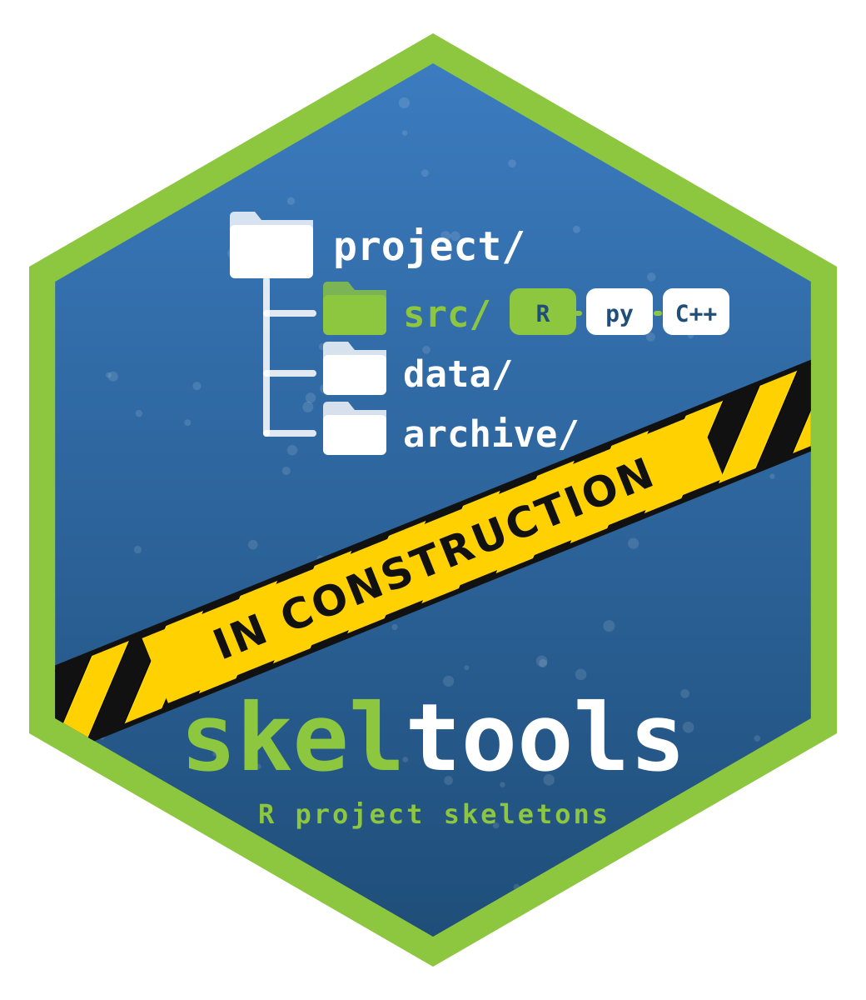

# skeltools 

Creates a standard project structure for R analyses, with optional Python, C/C++ and Quarto layers.

## Repository layout

```
skeltools/
├── logo/                hexagonal logo
└── trunk/
    ├── skeltools/       R package sources
    ├── documentation/   reference manual (PDF)
    └── Rpackage/        package archives
        ├── skeltools_<version>.tar.gz                        compressed sources
        └── skeltools_<version>_R_x86_64-pc-linux-gnu.tar.gz  Linux binary
```

## Installation

```r
# from GitHub (the package lives in a subfolder)
remotes::install_github("badozor/skeltools", subdir = "trunk/skeltools")

# or from the downloaded source archive (all platforms)
install.packages("skeltools_0.1.0.tar.gz", repos = NULL, type = "source")
```

The package is written in pure R. The source archive therefore installs on Linux,
macOS and Windows without a compiler. The binary provided is built on Linux.

## Usage

```r
library(skeltools)
create_project("~/projects/myproject")                            # R only
create_project("~/projects/myproject", python = TRUE)             # + Python
create_project("~/projects/myproject", python = TRUE, cpp = TRUE,
               quarto = TRUE, git = TRUE, open = TRUE)            # everything
list_layers()                                                     # available layers

# Python environment myenv/ (python -m venv + pip install -r requirements.txt)
create_project("~/projects/myproject", venv = TRUE,
               python_bin = "/usr/local/bin/python3")
create_venv("~/projects/myproject")                               # existing project

# Quarto report in an existing project
create_qmd("~/projects/myproject/analysis", title = "First analysis")
```

In RStudio: **File > New Project > New Directory > Analysis project (skeltools)**.
The form offers Python, Python environment, C/C++, Quarto and git checkboxes.

## Created structure

```
myproject/
├── data/          data (content ignored by git)
├── archive/       old versions, abandoned scripts
├── tmp/           temporary files (content ignored by git)
├── src/
│   ├── R/         00_setup.R (+ 01_cpp.R with cpp = TRUE)
│   ├── python/    main.py              (python = TRUE)
│   └── cpp/       hello.cpp, via Rcpp  (cpp = TRUE)
├── myproject.Rproj
├── myproject.qmd                       (quarto = TRUE)
├── references.bib                      (quarto = TRUE)
├── README.md
├── .gitignore
├── requirements.txt                    (python = TRUE)
└── myenv/                              (venv = TRUE, ignored by git)
```

## Python environment

`create_venv()` runs, from R, the equivalent of:

```bash
cd path_for_project
path_for_python/python -m venv myenv
source myenv/bin/activate
pip install -r requirements.txt
```

`requirements.txt` lists pooch, scanpy, pandas, numpy, seaborn, igraph,
leidenalg, scipy, scikit-learn, datasets and ipykernel. Edit it before creating
the environment to change the packages. When `ipykernel` is installed, the
environment is also registered as the Jupyter kernel `myenv`, inside the
environment itself (`python -m ipykernel install --sys-prefix --name myenv`).
Each project therefore has its own environment and its own kernel, and nothing
is written outside the project folder. The kernel is visible to Jupyter and
Quarto once the environment is activated (`source myenv/bin/activate`). The Quarto template refers to the same
environment (`Jupyter: myenv`, `use_virtualenv("myenv")`).

## Quarto report

`create_qmd()` writes a Quarto report from the package template: YAML header
(author, ORCID, email, `params`, bibliography), a setup chunk that sources
`src/R/*.R`, the sections Objective, Data, Methods, Results, Discussion and
References, and an appendix with `sessionInfo()`. An empty `references.bib` is
created next to it. Set your own author details once, for example in `.Rprofile`:

```r
options(skeltools.author = "Jane Doe", skeltools.orcid = "", skeltools.email = "")
```

An empty ORCID or email removes the line. Render with `quarto render myproject.qmd`.

## Adding a layer

Create `trunk/skeltools/inst/templates/<layer>/` with:

| Element | Role |
|---|---|
| `files/` | files copied into the project |
| `gitignore` | fragment appended to `.gitignore` |
| `structure.md` | rows of the README structure table |
| `start.md` | paragraph of the README "Getting started" section |

Conventions in `files/`: `{{name}}` and `{{date}}` are replaced in the content,
`__name__` in file names, and the `dot-` prefix becomes `.`
(`dot-gitkeep` gives `.gitkeep`, which prevents `R CMD build` from dropping hidden files).

Template files must be text files. After reinstalling the package, the new layer is
available without changing the code: `create_project("myproject", layers = "<layer>")`.
To offer it in RStudio, add a checkbox to
`trunk/skeltools/inst/rstudio/templates/project/skeltools.dcf` and pass it on in
`rstudio_project()`.

## Building the archives and the documentation

From `trunk/`:

```bash
R CMD build skeltools                                  # compressed sources
R CMD check --as-cran skeltools_0.1.0.tar.gz           # checks
R CMD INSTALL --build skeltools_0.1.0.tar.gz           # binary
mv skeltools_0.1.0*.tar.gz Rpackage/
R CMD Rd2pdf --no-preview --force -o documentation/skeltools_0.1.0.pdf skeltools
```

## Licence

GPL (>= 3)
